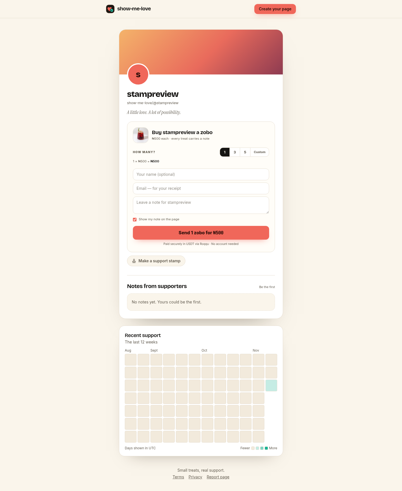
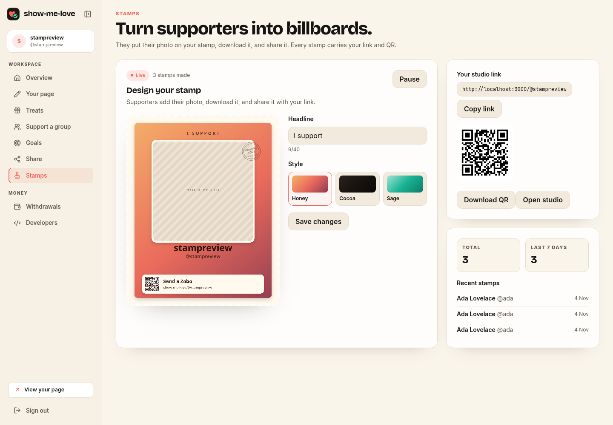
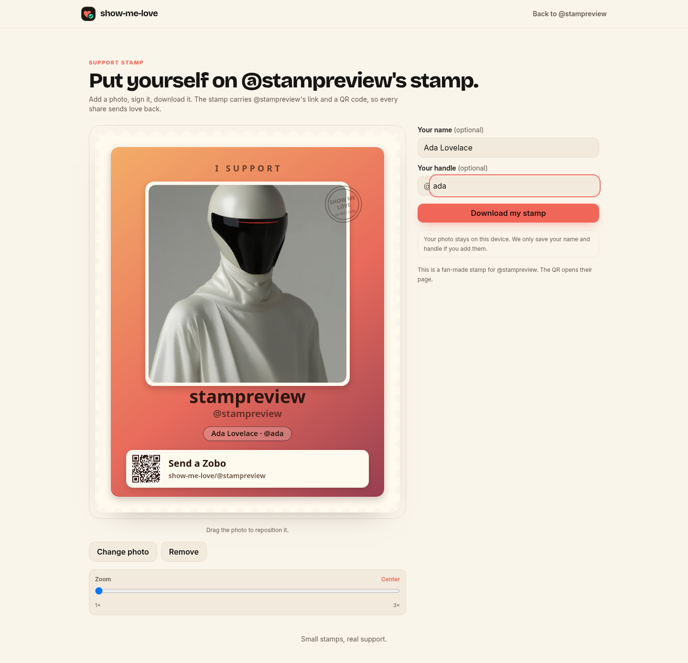
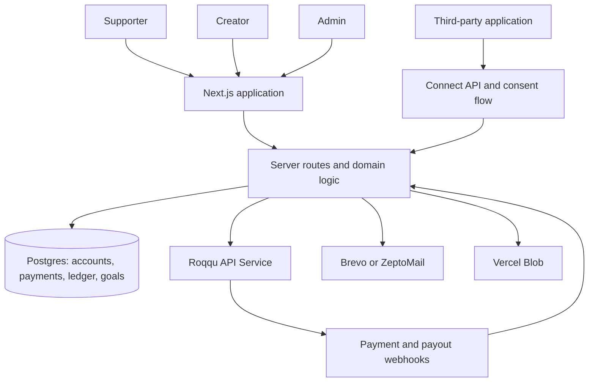

# Show Me Love

### Small treats. Real support.

A creator support platform that turns a simple gesture—“let me buy you a zobo”—into a contribution. Creators share a personal page, supporters buy a virtual treat, and payments are tracked in USDT through Roqqu API Service (RAS).

**[Live demo](https://show-me-love.vercel.app/) · [Quick start](#quick-start) · [Demo walkthrough](#demo-walkthrough) · [Developer integration](examples/connect-starter/README.md)**



## The problem

Creators, independent builders, and community organizers need a simple way to turn appreciation into financial support. A payment address alone does little to explain what someone is supporting, make the experience personal, or help a creator manage contributions afterward.

Show Me Love brings the support page, checkout, contribution history, goals, and withdrawal workflow together. Familiar treats such as zobo, suya, jollof, and coffee make the experience feel personal, with a focus on Nigerian creators and their communities.

## What it does

| Capability | Experience |
| --- | --- |
| Personal creator pages | Claim a link such as `/@ada`, customize a profile, and choose a treat and price. |
| Treat checkout | Support a creator without a supporter account; add a name, receipt email, and optional public note. |
| USDT payments | Generate Roqqu payment links, with direct wallet checkout for supported BEP20 payment addresses. |
| Creator dashboard | View contributions, balance, supporter activity, and withdrawal history. |
| Funding goals | Publish a goal with its own contribution flow and progress tracking. |
| Group support | Support multiple creators through a shared checkout and split allocation. |
| Support stamps | Create a campaign and let visitors personalize and download a shareable support image. |
| Developer Connect | Register sandbox or live apps, issue API keys, and connect creator accounts through a consent flow. |
| Admin tools | Review withdrawals, inspect payment activity, handle reports, and manage refunds. |

Treats represent financial contributions; the app does not arrange food or drink delivery.

## How it works

1. **Create a page.** Sign up, claim a username, and choose the treat supporters can buy.
2. **Share the link.** Add the page to a social profile, community, or project.
3. **Receive support.** A supporter chooses a quantity, leaves a note, and opens checkout.
4. **Confirm the payment.** Roqqu events drive payment status and the creator's ledger entries.
5. **Withdraw earnings.** Request a USDT wallet payout or a Nigerian bank withdrawal. Bank withdrawals and qualifying wallet withdrawals enter admin review.

Support stamps offer another way to participate: visitors can create a shareable image without making a payment.

## Demo walkthrough

Open the **[live demo](https://show-me-love.vercel.app/)** to explore the product. For a repeatable walkthrough with simulated payments, use the local practice environment below. The hosted deployment's payment mode depends on its configuration.

| Step | What to demonstrate |
| --- | --- |
| 1. Creator onboarding | Create an account, claim a username, and set up a treat. |
| 2. Public support page | Open the creator link in another browser session and choose a contribution. |
| 3. Payment confirmation | In local practice mode, simulate the payment and show the updated dashboard. |
| 4. Community features | Create a funding goal, explore group support, or download a support stamp. |
| 5. Withdrawal lifecycle | Request a withdrawal, complete verification, and review it using an authorized admin account. |
| 6. Developer platform | Create a sandbox app in Developers and run the [Connect starter](examples/connect-starter/README.md). |

### Product gallery

| Creator dashboard | Support stamp studio |
| --- | --- |
|  |  |

Screenshots show development sample data. More mobile captures are available in [docs/screenshots/375](docs/screenshots/375).

## Architecture



### Technology stack

| Layer | Technology |
| --- | --- |
| Application | Next.js 15 App Router, React 19, TypeScript |
| Interface | Tailwind CSS 3, Lucide icons |
| Data | Postgres with the `postgres` driver; PGlite for local development and tests |
| Payments and payouts | Roqqu API Service; Viem, Wagmi, and WalletConnect for wallet connectivity |
| Authentication | Password and email-link flows; signed sessions using `jose` |
| Email and storage | Brevo or ZeptoMail; Vercel Blob for uploaded images |
| Verification | Vitest; Playwright smoke and responsive scripts |
| Deployment configuration | Vercel, with a scheduled reconciliation route |

### Payment integrity and access controls

- An append-only ledger records credits, fees, holds, releases, reversals, and payouts. Unique references prevent duplicate ledger entries.
- Core USDT amount calculations use integer micro-units through `BigInt`.
- Payment and payout handlers process encrypted Roqqu webhook events.
- Withdrawals use verification codes, balance checks, and review rules.
- Admin access requires an allowlisted email address and a successful email-link sign-in.
- Connect includes registered redirect URLs, creator consent, revocable connections, and hashed API keys.
- Production startup validates required configuration. Live execution additionally requires an explicit execution flag.

These are implemented controls, not a claim of an independent security audit.

## Quick start

**Requirements:** Node.js 22+, npm, and Git. Local practice mode requires no external payment, database, or email account.

### 1. Clone and install

```bash
git clone https://github.com/Obiajulu-gif/show_me_love.git
cd show_me_love
npm ci
```

### 2. Configure the local environment

Copy [`.env.example`](.env.example) to `.env.local` (`cp .env.example .env.local` on macOS/Linux or `Copy-Item .env.example .env.local` in PowerShell).

Set these values in `.env.local`:

```dotenv
DATABASE_URL=postgres://postgres@127.0.0.1:54330/postgres
PUBLIC_APP_URL=http://localhost:3000
RAS_MODE=practice
ADMIN_EMAILS=you@example.com
```

Also set `SESSION_SECRET` and `CRON_SECRET` to separate random values. Run this command twice to generate them:

```bash
node -e "console.log(require('node:crypto').randomBytes(32).toString('hex'))"
```

Use an email address you control for `ADMIN_EMAILS`. Leave payment and email provider keys empty for the local walkthrough. Environment files containing real credentials must stay out of Git.

### 3. Start the database and app

In one terminal:

```bash
npm run db:local
```

Keep it running. The script starts a persistent PGlite database on port `54330` and applies the schema automatically.

In a second terminal:

```bash
npm run dev
```

Open [http://localhost:3000](http://localhost:3000). In development without an email provider, sign-in links and withdrawal verification codes are exposed as development hints. Those hints are disabled in production.

### Optional demo data

With the local app and database running, set `DEMO_PASSWORD` in your shell to a password of your choice, then run:

```bash
node scripts/seed-demo.mjs
```

The script creates `demo@show-me-love.test`, a creator profile, and three simulated contributions with public notes. It requires practice mode and can be rerun safely. `BASE_URL` defaults to `http://localhost:3000`.

## Verification

### Automated checks

```bash
npm test
npm run typecheck
```

The Vitest suite uses an in-memory database and covers payments, withdrawals, ledger behavior, authentication, goals, groups, stamps, Connect, and other application flows. Run the application once before typechecking a fresh checkout so Next.js generates its environment types.

### Browser smoke test

Run the local app in practice mode with `ADMIN_EMAILS=smoke+admin@show-me-love.test` and a configured `CRON_SECRET`. In the script's terminal, set `CRON_SECRET` to the same value, then run:

```bash
npx playwright install chromium
node scripts/smoke.mjs
```

The smoke script exercises onboarding, checkout, simulated payment, withdrawal review, goals, groups, and the Connect lifecycle. It exits with the failing step if something breaks. Allow roughly three minutes for the simulated settlement delay. Repeated runs can reach the signup rate limit of ten per hour per IP.

For the mobile layout check:

```bash
node scripts/responsive.mjs
```

This checks key screens at 375px, fails on horizontal overflow, and saves captures to `docs/screenshots/375/`. Both browser scripts accept `BASE_URL` in the shell environment for a different local origin.

## Payment modes

| `RAS_MODE` | Behavior | Configuration |
| --- | --- | --- |
| `practice` | Simulated payments and payouts; no funds move. | No Roqqu key required. Production also requires `ALLOW_PRACTICE=true`. |
| `test` | Calls Roqqu's staging service. | `RAS_TEST_KEY` |
| `live` | Real payment and payout execution. | `RAS_LIVE_KEY` and `ALLOW_PRODUCTION_EXECUTION=true` |

The simulated payment endpoint and controls are available only in practice mode. Production requires an explicit `RAS_MODE`.

Wallet checkout supports USDT on BNB Smart Chain for live BEP20 payment addresses. Test wallet checkout requires `WALLET_TEST_USDT` and, if needed, `WALLET_TEST_USDT_DECIMALS`. Set `NEXT_PUBLIC_WC_PROJECT_ID` to enable WalletConnect; browser-extension wallets remain available without it.

## Deployment

The existing public site is **[show-me-love.vercel.app](https://show-me-love.vercel.app/)**. To configure your own deployment:

1. Provision a Postgres database and set `DATABASE_URL` in your shell before running `npm run db:migrate`.
2. Import this repository into Vercel and configure the environment variables below.
3. Use `npm run build` as the build command. For a self-hosted production server, follow the build with `npm start`.
4. Register `https://<your-domain>/api/ras/webhook` in Roqqu and verify a test payment and payout before enabling live execution.

| Variable | Purpose |
| --- | --- |
| `DATABASE_URL` | Production Postgres connection string |
| `SESSION_SECRET` | Random session-signing secret, at least 32 characters |
| `PUBLIC_APP_URL` | Public HTTPS origin, without a trailing slash |
| `RAS_MODE` | Explicit payment mode; use `test` for staging verification |
| `RAS_TEST_KEY` / `RAS_LIVE_KEY` | Credentials for the selected Roqqu environment |
| `ALLOW_PRODUCTION_EXECUTION` | Must be `true` to execute live payments and payouts |
| `BREVO_API_KEY`, `BREVO_SENDER` | Transactional email credentials and verified sender |
| `ZEPTOMAIL_API_KEY`, `ZEPTOMAIL_SENDER` | Alternative email provider when Brevo is not configured |
| `BLOB_READ_WRITE_TOKEN` | Vercel Blob credentials for production image uploads |
| `CRON_SECRET` | Bearer token for the reconciliation route |
| `ADMIN_EMAILS` | Comma-separated admin email allowlist |
| `PLATFORM_FEE_BPS` | Platform fee in basis points; defaults to `500` (5%) |
| `NGN_PAYOUT_FEE`, `DAILY_WITHDRAW_USD` | Payout configuration; defaults to `50` and `500` respectively |

See [`.env.example`](.env.example) for additional settings and [proxy/README.md](proxy/README.md) for the optional fixed-IP Roqqu relay.

### Reconciliation schedule

[`vercel.json`](vercel.json) schedules `/api/cron/expire` at `03:00 UTC` daily. The route expires stale payments and reconciles pending sends; requests require `Authorization: Bearer <CRON_SECRET>`. Pending payments also expire when their status is read.

With the daily schedule, a missed payout webhook can leave a withdrawal pending until reconciliation runs. For shorter recovery intervals, configure an external scheduler to call the route every five minutes.

## Repository guide

| Path | Contents |
| --- | --- |
| [`src/app`](src/app) | Public pages, dashboard, admin console, and API routes |
| [`src/components`](src/components) | Checkout, goals, groups, stamps, and shared UI |
| [`src/lib`](src/lib) | Payment logic, ledger, authentication, withdrawals, and integrations |
| [`db/schema.sql`](db/schema.sql) | Database schema |
| [`tests`](tests) | Vitest test suites |
| [`scripts`](scripts) | Database tools, demo seeding, and browser checks |
| [`examples/connect-starter`](examples/connect-starter) | Standalone example for third-party integrations |
| [`proxy`](proxy) | Optional Roqqu relay service |
| [`docs/screenshots`](docs/screenshots) | Product and mobile screenshots |

## Current scope and next steps

The repository implements the creator support workflow and the community and developer features described above. Practice-mode demonstrations are separate from verification against Roqqu's staging or live services. Nigerian bank withdrawals currently require an administrator to complete the payout and mark it paid.

Next steps for a broader rollout include documenting staging payment and payout results, improving reconciliation frequency, and validating provider behavior under production traffic.

## Maintainer

Maintained by **[Obiajulu-gif](https://github.com/Obiajulu-gif)**. For bugs or feedback, [open an issue](https://github.com/Obiajulu-gif/show_me_love/issues) with reproduction steps and the payment mode used. Keep credentials and personal payment details out of public reports.
